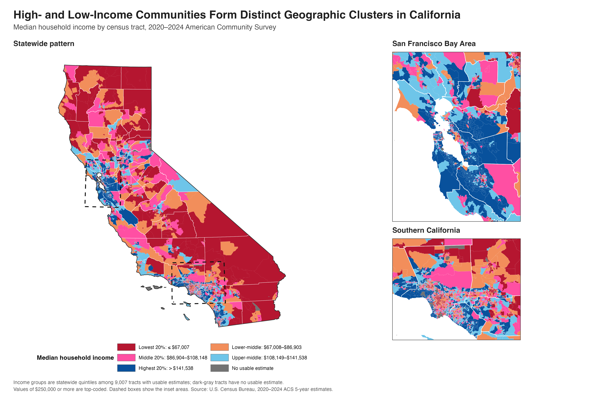
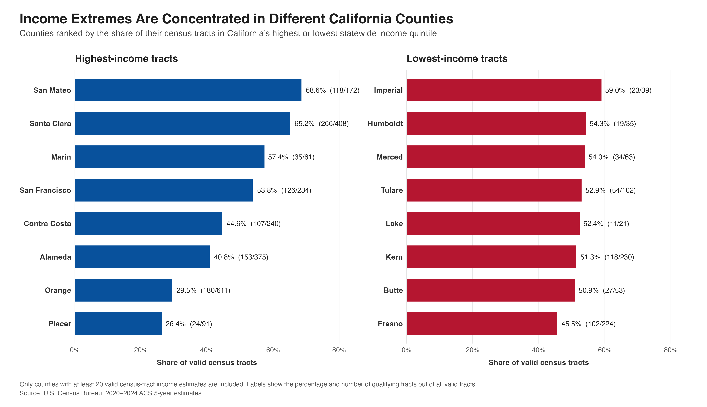

Hello everyone and welcome back! 

I know we all had a tough midterm week, but I hope we all can survive! So, today I want to talk about California! California has always been one of my favorite places to visit. I have been there several times, and in fall 2024, I studied at the University of Southern California for one semester. Living in Los Angeles was different from visiting it for a short trip. I began to notice how quickly the surroundings could change from one area to another.

Near USC, I often saw litter, visible homelessness, and streets where I felt less safe. When I went to UCLA in Westwood or nearby Beverly Hills, the area usually felt cleaner, quieter, and more orderly. The homes and public spaces also looked very different, even though these places were in the same city.

I knew that my personal impressions were not enough to prove an income pattern. However, they led me to a question that I could study with data: **where are high- and low-income communities concentrated across California?**

## Data and Method

I use census-tract data from the U.S. Census Bureau’s [2020–2024 American Community Survey](https://www.census.gov/programs-surveys/acs/data.html). A census tract is a small geographic area that usually contains a few thousand people, so it gives a more local view than a county or state average.

My main variable is median household income, `B19013_001`. I also use total population, `B01003_001`, to identify tracts with no reported population. Because the ACS is a survey, these values are estimates rather than exact counts.

The data include 9,129 California tracts. Of these, 9,007 have usable income estimates. I sort them into five equal groups based on California’s income distribution. The lowest group has a median household income of \$67,007 or less, while the highest group is above \$141,538. These categories are comparisons within California, not official definitions of low or high income. Tracts without usable estimates are shown in dark gray.

I used R to download and clean the data, join the income estimates to tract boundaries, and create the figures. I also transformed the spatial data to the California Albers projection, EPSG:3310. The complete code, data, results, and replication instructions are in my [GitHub repository](https://github.com/Changlin-DU/GIS_Data_Visualization).

## What Does the Map Show?

{#fig-california-income fig-alt="Map of California census tracts divided into five statewide median household income groups, with inset maps for the San Francisco Bay Area and Southern California." width="100%"}

What stood out to me first in @fig-california-income was the concentration of highest-income tracts around the San Francisco Bay Area. The dark-blue areas extend across several nearby counties, so the pattern is not limited to San Francisco itself.

Lower-income tracts are more common in parts of the Central Valley, northern California, and southeastern California. Southern California looks more mixed. High-, middle-, and low-income tracts appear close to one another across the Los Angeles region. This matched what I had noticed while living there. The divide is not only between separate regions; it can also appear within the same metropolitan area.

One detail requires care. Rural tracts often cover much more land than urban tracts, but they may contain fewer people. The map shows where each income group is located. A larger colored area does not necessarily represent a larger population.

## Comparing Counties

{#fig-county-concentration fig-alt="Two horizontal bar charts showing California counties with the largest shares of highest-income and lowest-income census tracts." width="100%"}

For @fig-county-concentration, I compare the share of each county’s valid tracts in the highest or lowest income group. I include only counties with at least 20 valid tracts so that counties with very few observations do not receive misleading rankings.

San Mateo has the largest high-income share at 68.6%, followed by Santa Clara at 65.2% and Marin at 57.4%. All three are in the Bay Area. Imperial has the largest low-income share at 59.0%. Humboldt, Merced, Tulare, Lake, Kern, Butte, and Fresno also have large shares of tracts in the lowest group.

These percentages describe census tracts, not residents. For example, San Mateo’s result does not mean that 68.6% of its residents are in the highest income group.

## What I Learned

The maps cannot tell me why these differences exist. Housing costs, job locations, transportation, and local history may all matter, but this analysis does not test those causes.

What I learned is that California’s income divide exists at more than one geographic level. There are broad differences across the state, but there are also sharp differences within Los Angeles and other urban areas. My experience in Los Angeles first made me notice the contrast. The GIS data show that it is part of a wider pattern that state and county averages can easily hide.