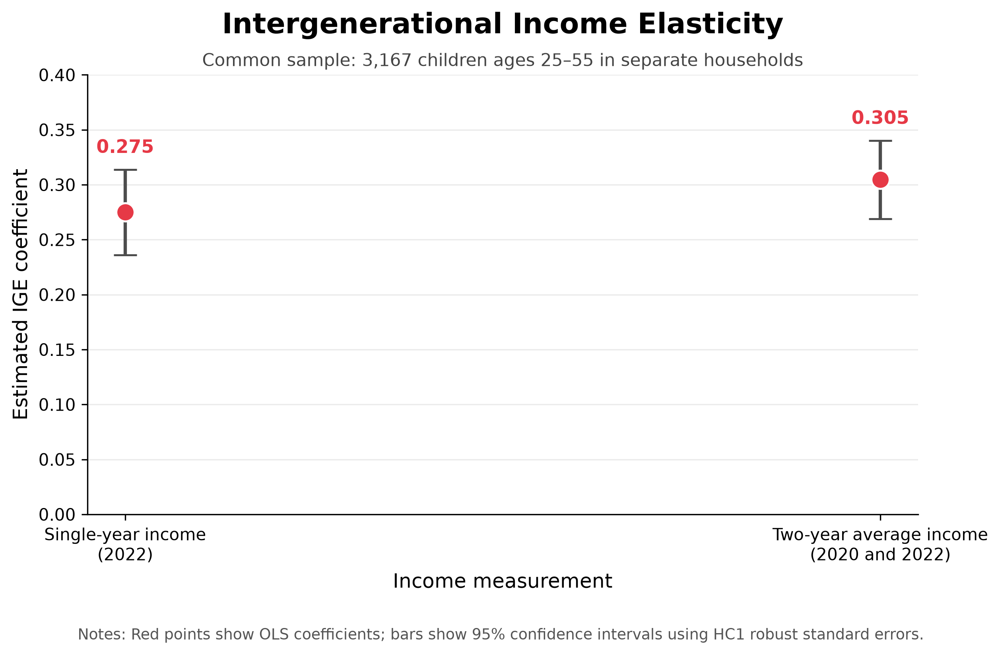
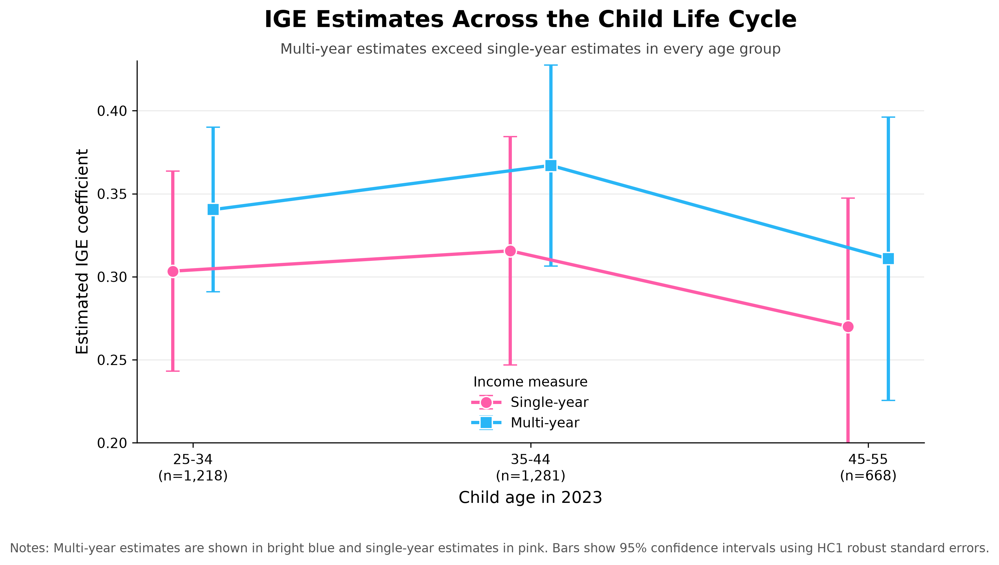

Hello everyone, welcome back! This time, the blog post is different than usual. I did a step-by-step tutorial using individual and family identifiers in longitudinal PSID data.

## Please read

PSID data cannot be accessed simply by applying for an API key. You need to create an account on the Panel Study of Income Dynamics (PSID) website and use the Data Center under the Data section to select the data you need. Before doing this, you should know exactly which variables you are looking for. If a dataset is not available through the Data Center, you may need to download it from Packaged Data instead. At least, this is how I obtained my files. If this does not work for you, please click the Help Desk and ask for help.

After selecting the variables and datasets, add all requests to your cart, choose your preferred file format, and complete the checkout process. PSID will email you a ZIP file containing the requested data. Download it promptly because the download link will expire.

This is the first step. I hope you are all able to access and download the data successfully. I also attached the website link in the next section.

## Why Parent–Child Matching Matters

Longitudinal datasets often store individual records, family records, and parent-child links separately. Before estimating intergenerational mobility, these files must be matched carefully. A join on the wrong identifier can assign a child to the wrong parent or create duplicate observations.

This tutorial uses DuckDB to run SQL inside Python. I first create permanent person identifiers, match children to their biological mothers and fathers, and aggregate the matched records to one observation per child. I then compare intergenerational income elasticity (IGE) using single-year and multi-year income.

The data are course-provided extracts from the [Panel Study of Income Dynamics](https://psidonline.isr.umich.edu/GettingStarted.aspx). Complete replication scripts are available in the repository linked below.

> Repository: [code and replication files](https://github.com/Changlin-DU/ParentsChildren_SQL_DataMerging.git)

## 1. Identify the variables

A PSID person is identified by the combination of a 1968 interview number and a person number. Both fields are required in every parent-child join.

| File and role | Variables | Purpose |
|---|---|---|
| Individual file | `ER30001`, `ER30002` | Permanent person identifier |
| 2021 individual record | `ER34901`, `ER34902`, `ER34904` | Family link, sequence number, and age |
| 2021 family record | `ER78002`, `ER81775` | Family identifier and 2020 income |
| 2023 individual record | `ER35101`, `ER35102`, `ER35104` | Family link, sequence number, and age |
| 2023 family record | `ER82002`, `ER85629` | Family identifier and 2022 income |
| Child | `PID2`, `PID3` | Child identifier |
| Biological mother | `PID4`, `PID5` | Mother identifier |
| Biological father | `PID23`, `PID24` | Father identifier |

The 2021 family record is linked through `ER34901 = ER78002`, while the 2023 record uses `ER35101 = ER82002`. The course extract already contains these family variables on each individual record.

The interviews report income from the previous calendar year. Therefore, `ER81775` measures 2020 income and `ER85629` measures 2022 income.

## 2. Load the files

The code below assumes the working directory is the root of the analysis repository. The individual extract is an Excel file. The Parent Identification File is fixed-width and has no header, so I assign its official `PID1`–`PID40` field names.

```python
from pathlib import Path

import duckdb
import numpy as np
import pandas as pd
import statsmodels.api as sm

raw_dir = Path("data/raw")

individuals = pd.read_excel(
    raw_dir / "blogpost6_parent_child_2021_2023.xlsx",
    sheet_name="Data",
    engine="calamine"
)

pid_names = [f"PID{i}" for i in range(1, 41)]

pid_widths = [
    1,
    4, 3, 4, 3, 4, 3, 4, 3,
    1, 1, 1, 1, 1, 1, 1, 1, 1, 1, 1, 1, 1,
    4, 3, 4, 3, 4, 3,
    1, 1, 1, 1, 1, 1, 1, 1, 1, 1, 1, 1
]

parent_ids = pd.read_fwf(
    raw_dir / "parent_identification_2023.txt",
    widths=pid_widths,
    names=pid_names,
    header=None
)

con = duckdb.connect()
con.register("individuals_raw", individuals)
con.register("parent_ids_raw", parent_ids)
```

Registering a pandas DataFrame makes it available to SQL without first exporting another file.

## 3. Standardize the identifiers

I use `SELECT` to keep the needed fields and give them readable names. `NULLIF()` converts a zero parent identifier to `NULL`.

```python
con.execute("""
    CREATE OR REPLACE TABLE individual_panel AS

    SELECT
        CAST(ER30001 AS BIGINT) AS person_1968_id,
        CAST(ER30002 AS BIGINT) AS person_number,
        CAST(ER34904 AS BIGINT) AS age_2021,
        CAST(ER35104 AS BIGINT) AS age_2023,
        CAST(ER78002 AS BIGINT) AS family_id_2021,
        CAST(ER82002 AS BIGINT) AS family_id_2023,
        CAST(ER81775 AS DOUBLE) AS family_income_2020,
        CAST(ER85629 AS DOUBLE) AS family_income_2022
    FROM individuals_raw
""")

con.execute("""
    CREATE OR REPLACE TABLE parent_links AS

    SELECT
        CAST(PID2 AS BIGINT) AS child_1968_id,
        CAST(PID3 AS BIGINT) AS child_person_number,
        NULLIF(CAST(PID4 AS BIGINT), 0) AS mother_1968_id,
        NULLIF(CAST(PID5 AS BIGINT), 0) AS mother_person_number,
        NULLIF(CAST(PID23 AS BIGINT), 0) AS father_1968_id,
        NULLIF(CAST(PID24 AS BIGINT), 0) AS father_person_number
    FROM parent_ids_raw
""")
```

## 4. Match children to parents

The first query matches children to biological mothers. The second repeats the join for fathers. `UNION ALL` stacks both sets of matches.

```python
con.execute("""
    CREATE OR REPLACE TABLE parent_child_pairs AS

    SELECT
        child.person_1968_id AS child_1968_id,
        child.person_number AS child_person_number,
        'mother' AS parent_type,
        mother.person_1968_id AS parent_1968_id,
        mother.person_number AS parent_person_number,
        child.age_2023 AS child_age_2023,
        child.family_id_2021 AS child_family_id_2021,
        child.family_id_2023 AS child_family_id_2023,
        mother.family_id_2021 AS parent_family_id_2021,
        mother.family_id_2023 AS parent_family_id_2023,
        child.family_income_2020 AS child_income_2020,
        child.family_income_2022 AS child_income_2022,
        mother.family_income_2020 AS parent_income_2020,
        mother.family_income_2022 AS parent_income_2022
    FROM parent_links AS links
    INNER JOIN individual_panel AS child
        ON links.child_1968_id = child.person_1968_id
        AND links.child_person_number = child.person_number
    INNER JOIN individual_panel AS mother
        ON links.mother_1968_id = mother.person_1968_id
        AND links.mother_person_number = mother.person_number

    UNION ALL

    SELECT
        child.person_1968_id,
        child.person_number,
        'father',
        father.person_1968_id,
        father.person_number,
        child.age_2023,
        child.family_id_2021,
        child.family_id_2023,
        father.family_id_2021,
        father.family_id_2023,
        child.family_income_2020,
        child.family_income_2022,
        father.family_income_2020,
        father.family_income_2022
    FROM parent_links AS links
    INNER JOIN individual_panel AS child
        ON links.child_1968_id = child.person_1968_id
        AND links.child_person_number = child.person_number
    INNER JOIN individual_panel AS father
        ON links.father_1968_id = father.person_1968_id
        AND links.father_person_number = father.person_number
""")
```

Using both parts of the permanent identifier prevents different people from the same original family from being treated as one person. These joins produced 23,938 parent-child pairs and 15,728 unique matched children before the income and age restrictions.

## 5. Construct the income measures

A child may match to one or two parents. `GROUP BY` returns one row per child. `AVG()` averages across two eligible parents when both are available and uses the one observed parent otherwise.

```python
con.execute("""
    CREATE OR REPLACE TABLE matched_children AS

    SELECT
        child_1968_id,
        child_person_number,
        MAX(child_age_2023) AS child_age_2023,
        MAX(child_income_2022) AS child_income_2022,

        CASE
            WHEN
                MAX(child_income_2020) > 0
                AND MAX(child_income_2022) > 0
            THEN
                (
                    MAX(child_income_2020)
                    + MAX(child_income_2022)
                ) / 2.0
            ELSE NULL
        END AS child_income_average,

        AVG(
            CASE
                WHEN
                    child_family_id_2023 > 0
                    AND parent_family_id_2023 > 0
                    AND child_family_id_2023
                        <> parent_family_id_2023
                    AND parent_income_2022 > 0
                THEN parent_income_2022
                ELSE NULL
            END
        ) AS parent_income_2022,

        AVG(
            CASE
                WHEN
                    child_family_id_2021 > 0
                    AND parent_family_id_2021 > 0
                    AND child_family_id_2023 > 0
                    AND parent_family_id_2023 > 0
                    AND child_family_id_2021
                        <> parent_family_id_2021
                    AND child_family_id_2023
                        <> parent_family_id_2023
                    AND parent_income_2020 > 0
                    AND parent_income_2022 > 0
                THEN
                    (
                        parent_income_2020
                        + parent_income_2022
                    ) / 2.0
                ELSE NULL
            END
        ) AS parent_income_average

    FROM parent_child_pairs

    GROUP BY
        child_1968_id,
        child_person_number
""")
```

The family-ID conditions exclude parent-child pairs assigned to the same household, where family income would be identical by construction. Averaging income across 2020 and 2022 also reduces the influence of temporary shocks, job transitions, and reporting variation.

## 6. Estimate IGE

The model is:

$$
\log(Y_{\text{child}})
=
\beta_0+
\beta_1\log(Y_{\text{parent}})
+\varepsilon
$$

The slope $\beta_1$ is the IGE. A coefficient of 0.30 means that 1% higher parental income is associated with approximately 0.30% higher child income.

```python
sample = con.execute("""
    SELECT *
    FROM matched_children
    WHERE
        child_age_2023 BETWEEN 25 AND 55
        AND child_income_2022 > 0
        AND parent_income_2022 > 0
        AND child_income_average > 0
        AND parent_income_average > 0
""").df()

def estimate_ige(data, child_income, parent_income):
    y = np.log(data[child_income])

    x = sm.add_constant(
        np.log(data[parent_income])
    )

    return sm.OLS(
        y,
        x
    ).fit(cov_type="HC1")

single_year_model = estimate_ige(
    sample,
    "child_income_2022",
    "parent_income_2022"
)

multi_year_model = estimate_ige(
    sample,
    "child_income_average",
    "parent_income_average"
)
```

The same 3,167 observations are used in both regressions.

| Income measure | Observations | IGE | Robust SE | $R^2$ |
|---|---:|---:|---:|---:|
| 2022 income | 3,167 | 0.275 | 0.020 | 0.073 |
| Average of 2020 and 2022 income | 3,167 | 0.305 | 0.018 | 0.092 |

{#fig-ige-comparison width=85%}

The multi-year estimate is about 10.8% larger. This pattern is consistent with temporary income variation attenuating the single-year estimate, although the comparison is descriptive rather than causal.

## 7. Check life-cycle sensitivity

I repeat the comparison for children ages 25–34, 35–44, and 45–55.

{#fig-ige-age width=90%}

The estimates vary across age groups, and the multi-year point estimate is higher in every group. This is consistent with life-cycle bias: income observed at one age may not represent long-run economic status equally well for everyone. The confidence intervals are wide, so the figure should be read as a sensitivity check rather than proof of a causal life-cycle effect.

## 8. Optional: Estimate a rank-rank model

Income ranks provide another way to describe intergenerational mobility. Unlike the log-log IGE model, the rank-rank model compares each child's position in the child income distribution with the parent's position in the parent income distribution:

$$
\operatorname{Rank}(Y_{\text{child}})
=
\beta_0
+
\beta_1\operatorname{Rank}(Y_{\text{parent}})
+
\varepsilon
$$

I use the same common sample and the multi-year income measures. In the code below, `pct=True` converts the income rankings to values between 0 and 1. `sm.add_constant()` adds the intercept $\beta_0$, while the coefficient on `parent_rank` estimates $\beta_1$.

```python
sample["child_rank"] = (
    sample["child_income_average"]
    .rank(method="average", pct=True)
)

sample["parent_rank"] = (
    sample["parent_income_average"]
    .rank(method="average", pct=True)
)

x = sm.add_constant(
    sample["parent_rank"]
)

rank_model = sm.OLS(
    sample["child_rank"],
    x
).fit(cov_type="HC1")
```

The estimated rank-rank coefficient is 0.313. Because the ranks are measured from 0 to 1, a 0.10 increase in parental income rank—equivalent to 10 percentiles—is associated with a 0.0313 increase in child income rank, or approximately 3.13 percentiles.

The positive coefficient indicates that children with higher-ranked parents also tend to occupy higher positions in their own generation's income distribution. As with the IGE estimates, this result describes an association and should not be interpreted as a causal effect of parental income.

## Takeaway

The main lesson I took from this exercise is that estimating the regression is the easy part; building a defensible parent-child sample is the real work. I needed both parts of the permanent person identifier, separate joins for mothers and fathers, and a final aggregation that returned the data to one row per child. I also had to exclude parent-child pairs who shared the same family record so that I was not regressing a household income measure on itself.

SQL made these decisions visible. I could inspect the selected fields, the join conditions, and the number of observations produced at each stage before moving to the regression in Python. In my results, the two-year average produced a larger IGE than the single-year measure, and the same pattern appeared in every child age group. This does not prove that the entire difference is caused by life-cycle bias, but it shows why one year of income may provide an incomplete measure of long-run economic status. For anyone reproducing this analysis, I would check the identifiers, duplicate matches, household exclusions, and regression sample before interpreting the final coefficient.