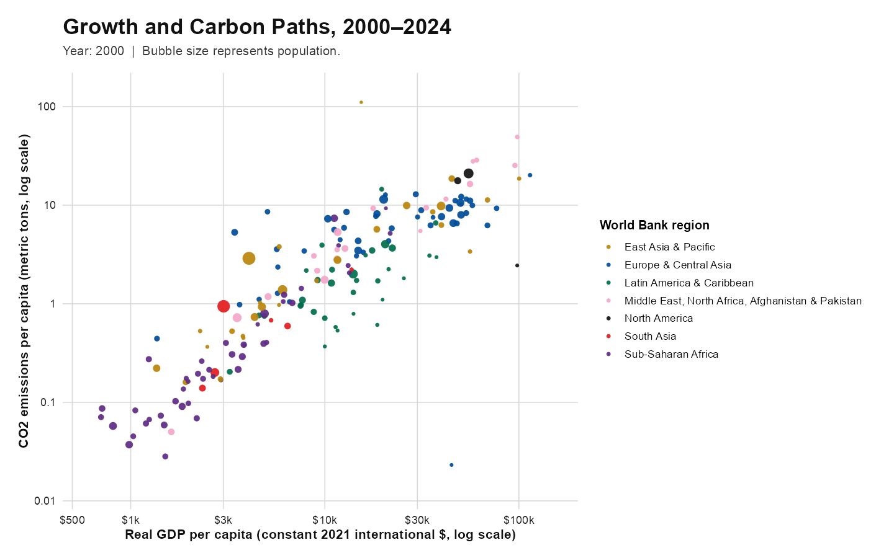

Hello everyone and welcome back! Today, I would like to discuss a brand new topic. I believe Global warming is a familiar term for everybody, and the Paris Agreement reflects a broad international effort to limit it. Countries are expected to set their own climate targets and reduce emissions while continuing to develop their economies. I agree with this ideal goal, but it made me wonder what this balance looks like in practice. Do countries actually have to choose between economic growth and lower carbon emissions? Whether every country follows its commitments is a much larger political question, and that is not what I want to discuss here. 

Instead, for this blog post I wanted to look at a question that sounds simple but is harder than it first appears: can a country become richer without producing more carbon emissions? 

This distinction matters to me because I think slower emissions growth is not the same as falling emissions. If GDP grows faster than emissions, the two are *relatively decoupled*. If GDP grows while emissions actually decline, that is *absolute decoupling*, which is the stronger result.

## Data and Method

I used the [World Bank World Development Indicators](https://databank.worldbank.org/source/world-development-indicators) to combine real GDP per capita, territorial CO2 emissions per capita, population, region, income group, and renewable electricity data. The final panel covers 182 countries between 2000 and 2024.

For the long-run comparison, I averaged each variable over 2000–2002 and 2022–2024. I then calculated its annualized change as

$$
g_X =
\left[
\left(
\frac{\overline{X}_{2022\text{--}2024}}
{\overline{X}_{2000\text{--}2002}}
\right)^{1/22}
-1
\right]\times 100,
$$

where $X$ is either real GDP per capita or CO2 emissions per capita. Using three-year averages reduces the effect of an unusually high or low single year.

Countries are classified using $g_{\mathrm{GDP}}$ and $g_{\mathrm{CO_2}}$:

- $g_{\mathrm{GDP}}\leq 0$: no sustained economic growth
- $g_{\mathrm{GDP}}>0$ and $g_{\mathrm{CO_2}}<0$: absolute decoupling
- $g_{\mathrm{GDP}}>0$ and $0\leq g_{\mathrm{CO_2}}<g_{\mathrm{GDP}}$: relative decoupling
- $g_{\mathrm{GDP}}>0$ and $g_{\mathrm{CO_2}}\geq g_{\mathrm{GDP}}$: no decoupling

The complete data-processing and visualization code is available in the [GitHub repository](https://github.com/Changlin-DU/Interactive_Plotly). After cloning the repository, the full analysis can be reproduced with:

```{r}
#| eval: false
source("code/run_all.R")
```

## How Did Countries Move over Time?

{fig-alt="Animated bubble chart showing GDP per capita and CO2 emissions per capita across countries from 2000 to 2024."}

[Open the fully interactive animation](global_decoupling_animation_copy.html){.btn .btn-primary target="_blank"}

The animation shows the familiar positive relationship between income and emissions, but it also shows that countries do not remain on one fixed path. China and India move strongly to the right as income rises, while several European countries move right and downward, combining higher income with lower per-capita emissions. The interactive version adds information that the GIF cannot show: the year slider makes changes over time easier to follow, the legend can isolate individual regions, and hovering identifies each country and reports its exact values.

## Who Achieved Long-Run Decoupling?

{fig-alt="Bubble chart classifying countries by long-run GDP and CO2 emissions growth."}

[Open the interactive long-run explorer](long_run_decoupling_explorer_copy.html){.btn .btn-primary target="_blank"}

Among the 182 countries, 60 achieved absolute decoupling and 61 achieved relative decoupling. Another 45 experienced emissions growth at least as fast as GDP, while 16 did not record sustained GDP-per-capita growth. In other words, roughly two-thirds of the countries show some form of decoupling, but only about one-third combined economic growth with an actual decline in per-capita emissions.

The pattern is also visible in the group medians. The median absolute-decoupling country had annualized GDP growth of about 1.1% and emissions growth of $-1.4\%$. For the relative-decoupling group, the corresponding values were about 2.9% and 1.7%. Emissions were still increasing in the second group, just more slowly than income.

The explorer opens in a focused range so the main cluster is readable. “Show all outliers” expands the scale to include Greenland and Lao PDR, whose unusually high emissions growth would otherwise compress the rest of the graph. Hovering also makes it possible to identify countries, inspect their exact growth rates, and compare countries that overlap in the static figure.

## Takeaway

Overall, I believe economic growth and carbon emissions are no longer moving together in exactly the same way everywhere. Many countries have weakened that relationship, and some have managed to raise income while cutting per-capita emissions. Still, relative decoupling remains slightly more common than absolute decoupling. The main lesson is therefore not that growth has become carbon-free, but that the connection between growth and emissions can change—and has already changed substantially in some countries.