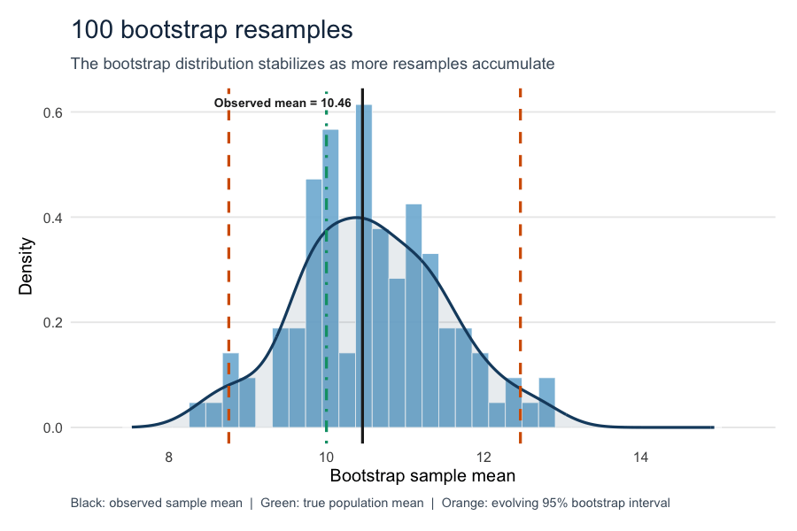
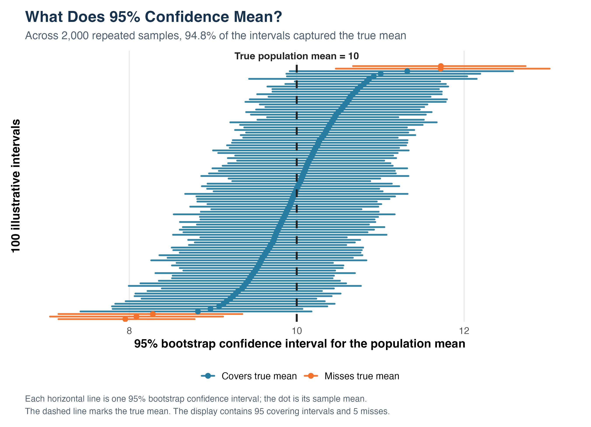
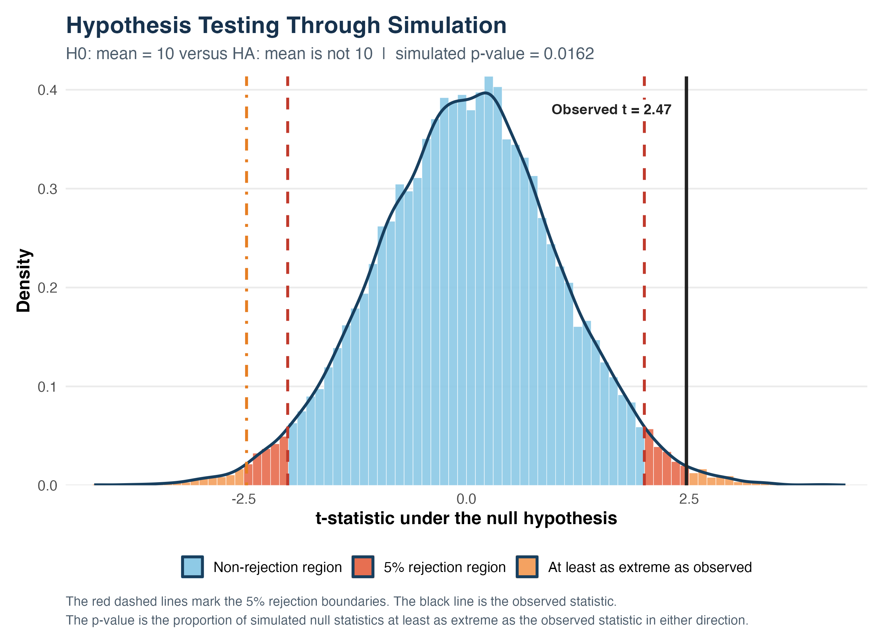

Hello everyone and welcome back! 

Happy Halloween! Did you guys enjoy the happy hour?

This time, I wanted to look at two terms that appear in almost every empirical study: confidence intervals and p-values. I believe most of us had seen both many times during our undergraduate studies. And I think these are the most fundamental concepts in econometrics and statistics. However, I realized that it is much easier to repeat their definitions than to explain what they actually mean. A 95% confidence interval does not mean that one calculated interval has a 95% probability of containing the true parameter. A p-value is also not the probability that the null hypothesis is true. These differences matter because they change how we interpret statistical results.

## Data and Method

I did not use an external dataset. All samples were generated in R with fixed random seeds. I first drew 50 observations from a right-skewed population with true mean $\mu=10$. From this sample, I repeatedly drew new samples of size 50 with replacement and calculated their means. With replacement means that one observation may appear several times in a bootstrap sample while another may not appear at all. I repeated this process 5,000 times.

For the coverage experiment, I generated 2,000 independent samples of size 50 from a normal population with $\mu=10$ and standard deviation 4. I constructed a 95% percentile bootstrap confidence interval for each sample using 800 resamples. For the hypothesis-testing example, I generated an observed sample from a normal population with mean 11 and tested it against a null mean of 10.

The complete code, generated data, figures, and replication instructions are available in the [GitHub repository](https://github.com/Changlin-DU/Simulation_and_Inference). After cloning the repository, the full project can be reproduced with:

```{r}
#| eval: false
source("codes/06_run_all.R")
```

## Building a Bootstrap Confidence Interval

{fig-alt="Animated histogram showing a bootstrap distribution stabilizing as the number of resamples increases."}

The observed sample mean was 10.459. The 2.5th and 97.5th percentiles of the 5,000 bootstrap means produced the interval $[8.800,12.205]$, which contains the true mean of 10. The original sample acts as a small stand-in for the population, and the bootstrap distribution shows how much the sample mean could vary.

[Open the interactive bootstrap explorer](bootstrap_explorer_copy.html){.btn .btn-primary target="_blank"}

The explorer allows the sample size, number of resamples, confidence level, and true mean to be changed. Increasing the number of resamples mainly makes the bootstrap distribution smoother. Increasing the original sample size reduces the uncertainty itself. In other words, more resamples cannot make up for limited information in the original sample.

## What Does 95% Confidence Mean?

{fig-alt="One hundred bootstrap confidence intervals, including 95 that cover the true mean and 5 that miss it."}

Across the 2,000 repeated samples, 1,896 intervals contained $\mu=10$ and 104 did not. The empirical coverage rate was therefore 94.8%, which is close to 95%. This is the interpretation that I find most useful: the confidence level describes how the procedure performs over many samples. Once one interval has been calculated, it either contains the fixed population mean or it does not.

## Testing a Null Hypothesis

I tested

$$
H_0:\mu=10
\qquad\text{against}\qquad
H_A:\mu\neq10.
$$

The observed sample had mean 11.387 and test statistic $t=2.469$. I then generated 20,000 samples assuming $H_0$ was true and calculated a t-statistic for each one.

{fig-alt="Simulated null distribution showing rejection boundaries near negative and positive two, with the observed t-statistic at 2.47."}

For a two-sided test with $\alpha=0.05$, the rejection region is divided between the lowest 2.5% and highest 2.5% of the null distribution. The simulated boundaries were approximately $-2.008$ and $1.997$. Since $t=2.469$ is beyond the upper boundary, it falls in the rejection region.

Only 323 simulated null statistics were at least as extreme as the observed value in either direction, producing $p=0.0162$. Since $p<0.05$, I reject $H_0$. This does not mean there is a 1.62% chance that $H_0$ is true. It means that if $H_0$ were true, a result this extreme would occur only about 1.62% of the time.

## Takeaway

Overall, my main takeaway is that both ideas depend on repeated sampling. A 95% confidence procedure captures the true parameter about 95% of the time, but not every time. A p-value tells us how unusual the observed statistic would be under the null hypothesis; it does not tell us the probability that the null is true. Simulation made these differences much easier for me to see.