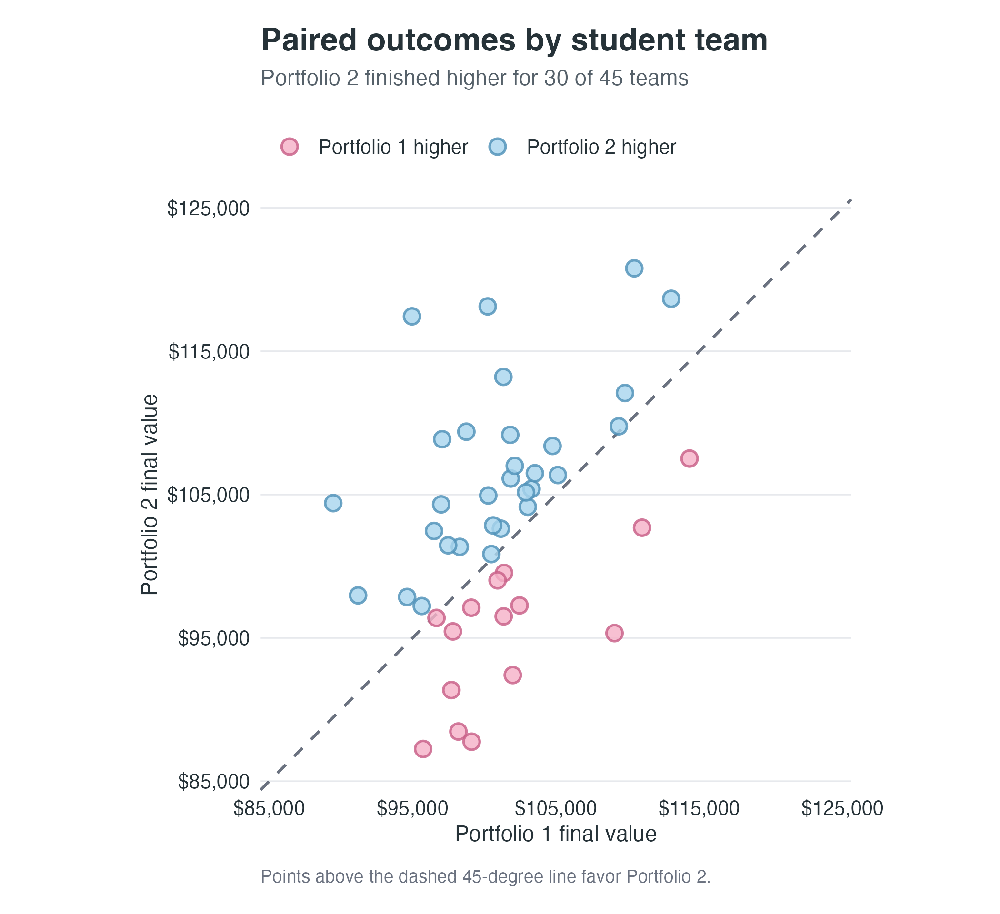
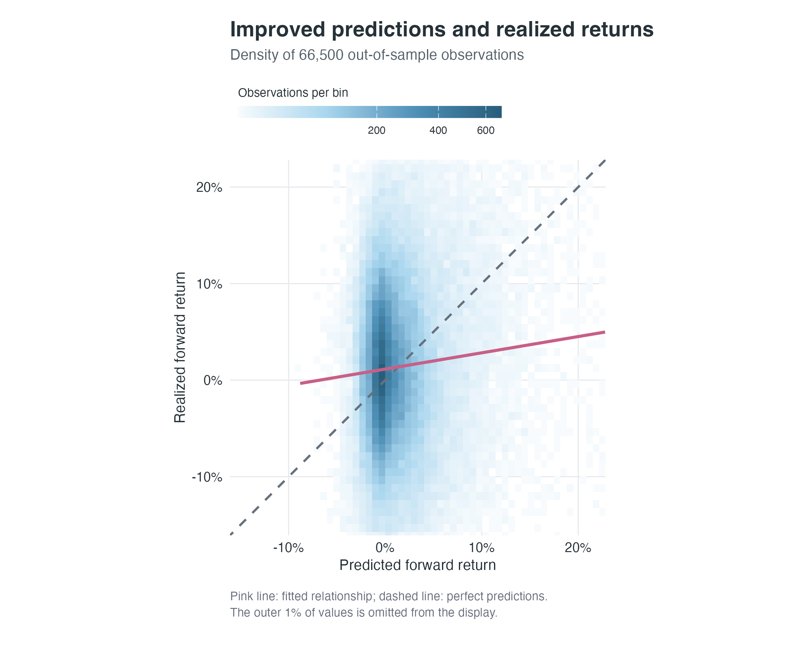
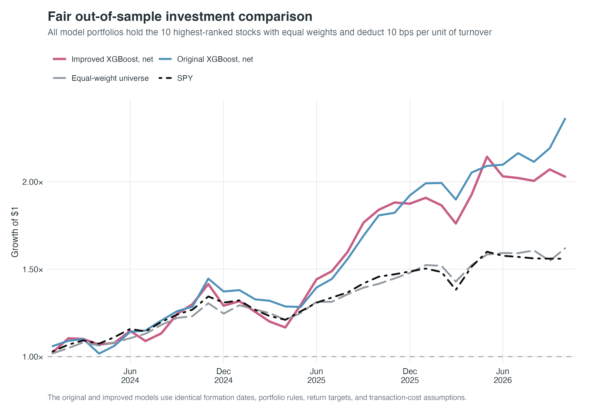

Hello everyone and welcome back!

I would like to share a relevant news. Over the past two days, I believe many of us have followed the reports about the scandal surrounding Jensen Huang and his [resignation from NVIDIA](https://nvidianews.nvidia.com/news/nvidia-announces-ceo-transition/). On November 12, NVIDIA shares [closed 4.34% lower](https://stockanalysis.com/stocks/nvda/market-cap/). This company lost roughly \$190 billion in market value in one day, leaving its market capitalization near \$4.005 trillion. This sudden change shows that NO model can anticipate every event that moves a stock. Thus, please remember the stock market is risky! Investing a small amount that one can afford to lose may be reasonable, but please do not treat it as a way to become rich quickly! Please be careful!

## 1. What did we learn from the class experiment?

The class experiment ran from August 18 to November 12, 2026. Each team started with two \$100,000 portfolios and did not rebalance after making the initial selections. Portfolio 1 was based mainly on students’ interests. Portfolio 2 was described as indicator-based, although its exact indicator and selection rule were not documented. I can therefore compare their results, but I cannot determine exactly which rule produced the difference.

Across 45 teams, Portfolio 1 ended with an average value of \$101,179, while Portfolio 2 averaged \$103,087. Portfolio 2 finished higher for 30 teams. Its average advantage was \$1,909, but the 95% confidence interval ranged from about -\$380 to \$4,197, and the paired-test p-value was 0.100. The evidence is not strong enough to conclude that Portfolio 2 consistently performed better.

{#fig-class-comparison fig-alt="Paired comparison of Portfolio 1 and Portfolio 2 final values for 45 student teams."}

My own five-stock portfolio gained about 19%, but Moderna alone generated roughly \$15,047 of that gain. One successful portfolio does not prove that its method worked. A single company, unexpected news, or a favorable market period can dominate the result.

Stock returns are difficult to predict because prices react quickly to new information, while future news is unknown. Relationships found in historical data may also weaken or reverse when market conditions change. A flexible model can learn patterns that happened by chance and then fail on new data.

## 2. How did I improve the original model?

The original model used XGBoost, which builds a sequence of decision trees, with each tree trying to correct earlier errors. I used daily Yahoo Finance data for 95 stocks and SPY as a market measure. The prediction target was each stock’s return over approximately the next 20 trading days. The original predictors included returns, momentum, volatility, volume, raw stock prices, and the SPY return.

For the improved model, I corrected the momentum calculations, removed raw price levels, and added 12-month momentum, excess momentum, market beta, drawdown, idiosyncratic volatility, and volume ratios.

I also divided model development by date. Earlier observations were used for training and validation. January 2024 through October 2026 remained strictly out of sample and was not used to choose features or hyperparameters. I selected the settings with the strongest validation rank correlation and then fitted the final model. This reduces look-ahead bias and gives a more honest test on unseen data.

All code, data documentation, saved results, and replication instructions are available in my [Stock_Returns GitHub repository](https://github.com/Changlin-DU/Stock_Returns).

```bash
Rscript code/01_class_experiment.R
Rscript code/02_reproduce_original_xgboost.R
Rscript code/03_improved_xgboost.R
Rscript code/04_fair_model_comparison.R
```

## 3. Did the improved model perform better out of sample?

The improved model showed a stronger relationship between predicted and realized returns. Pearson correlation increased from 0.028 to 0.107, rank correlation increased from 0.035 to 0.043, and RMSE decreased from 0.0935 to 0.0918. However, the historical-mean benchmark had a lower RMSE of 0.0889. Both XGBoost models also had negative out-of-sample \(R^2\) values. The improved model ranked stocks somewhat better, but it still could not predict the size of future returns accurately.

{#fig-improved-predictions fig-alt="Density plot comparing improved XGBoost predictions with realized forward stock returns."}

For the investment comparison, both models selected the ten highest-ranked stocks each month, used equal weights, and deducted 10 basis points per unit of turnover. I compared them with the equal-weight stock universe and SPY over the same months.

The original model earned a 35.4% annualized return, compared with 28.4% for the improved model, 18.5% for the equal-weight universe, and 17.0% for SPY. Although the improved strategy beat both simple benchmarks during this period, it had 19.6% annualized volatility and a 17.5% maximum drawdown. Its Sharpe ratio was 1.38, below the original model’s 2.02 and the equal-weight benchmark’s 1.71. Its monthly return differences from the other strategies were not statistically significant.

{#fig-fair-returns fig-alt="Cumulative out-of-sample returns for the original XGBoost model, improved model, equal-weight universe, and SPY."}

## Takeaway

Overall, my main takeaway is that the additional features and more careful validation improved some prediction measures, but they did not produce a better investment strategy. The model found a small ranking signal, but that signal was weak and unstable. A complicated model can look promising without providing reliable evidence that stock returns are consistently predictable. The recent NVIDIA event reinforces the same lesson: unexpected information can change a company’s value almost immediately, so stock-market predictions should always be treated with caution.